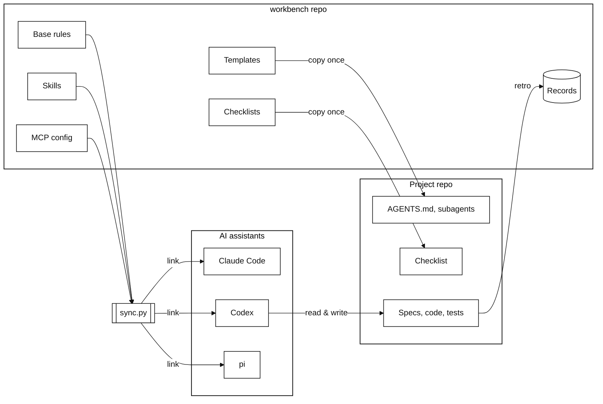
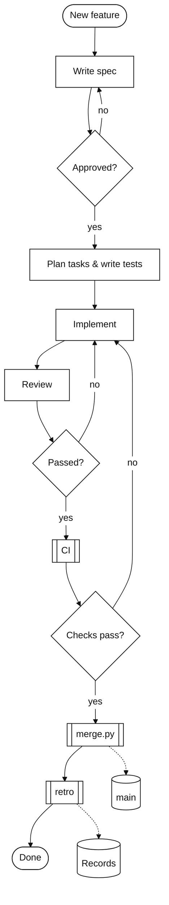

# workbench

[简体中文](README.md) | English

A personal AI coding workflow repository that keeps Claude Code, Codex, and pi following the same rules, skills, and checks across different project repositories.

Principles: anything reused across repositories lives here, while anything specific to one project stays in that project; anything a tool can check is left to the tool rather than written into prompts.

## Architecture

### Architecture diagram



### Workflow diagram



## Directory layout

```
workbench/
├── base/                     # Base layer: shared by all repositories and assistants
│   ├── AGENTS.md             # Engineering principles, 60 lines or fewer
│   └── CLAUDE.md             # A single line: @AGENTS.md
├── docs/workflow.md          # Workflow details: task breakdown, issue handling, final acceptance
├── skills/                   # General skills, one action per skill
│   ├── code-review/SKILL.md  # Code review
│   ├── write-tests/SKILL.md  # Writing tests
│   ├── tech-research/SKILL.md # Research for new features
│   ├── requirements-design/  # Requirements design: SKILL.md plus reference files by feature type
│   ├── retro/SKILL.md        # Retrospective: aggregates progress, issues, and baseline data
│   └── role-*/               # 6 collaboration roles: product manager, lead, planner, executor, reviewer, specialist reviewer
├── templates/
│   ├── algorithm/            # Template for Go algorithm-practice repositories (see TEMPLATE.md)
│   └── fullstack/            # Template for frontend/backend multi-agent work: subagent configs, API impact index, test-protection hook
├── .github/workflows/
│   ├── go-ci.yml             # Reusable CI: gofmt, vet, golangci-lint, test; opens an issue when main fails
│   └── ci.yml                # CI for this repository (tests for the sync scripts)
├── mcp/servers.json          # Shared MCP servers, in the standard mcpServers format
├── configs/targets.toml      # Where each tool reads rules, skills, and MCP settings
├── scripts/
│   ├── bootstrap.py          # New machine setup: checks tools, installs ccusage, configures the status line
│   ├── sync.py               # Sync: distributes the base layer, skills, and MCP settings
│   └── merge.py              # Merge: squash-merges only when all checks pass (guardrail layer 3)
├── tests/                    # Tests for the scripts
└── evals/                    # Test-point checklists, common-issues checklist, cross-project records (progress, issues, baseline)
```

## New machine setup

```sh
python scripts/bootstrap.py --dry-run   # Preview the changes first
python scripts/bootstrap.py
```

Lists missing tools with their install commands, installs ccusage with npm, and adds the `ccusage statusline` status line to `~/.claude/settings.json` (an existing custom status line is kept unless `--force` is given).

## Syncing to each tool

Requires Python 3.11 or later, with no dependencies to install. From the root of this repository:

```sh
python scripts/sync.py --dry-run   # Preview the changes first
python scripts/sync.py             # Apply
```

Windows, WSL, and Linux each have their own home directory, so run it once in each environment.

What is synced and where is defined in [configs/targets.toml](configs/targets.toml):

| Content | Claude Code | Codex | pi |
|---------|-------------|-------|----|
| Base layer | ~/.claude/AGENTS.md + CLAUDE.md | ~/.codex/AGENTS.md | ~/.pi/agent/AGENTS.md |
| Skills | ~/.claude/skills/ | ~/.agents/skills/ | ~/.agents/skills/ |
| MCP | `claude mcp add-json --scope user` | mcp_servers in ~/.codex/config.toml | ~/.config/mcp/mcp.json (requires pi-mcp-adapter) |

Script behavior:

- Creates symbolic links where possible; on Windows without Developer Mode it falls back to copying (re-run after changing this repository).
- Backs up existing files to `~/.workbench-backup/<date>/` before overwriting them.
- In Codex's config.toml, only `[mcp_servers.<name>]` tables with the same name are replaced and all other settings are kept; in pi's mcp.json, only entries with the same name are replaced.
- Running it again produces the same result; the second run reports that everything is up to date.

## MCP

Edit only [mcp/servers.json](mcp/servers.json); the other formats are generated by the sync script. Secrets are written only as `${VAR}` environment-variable references, for example to add an API key for Context7:

```json
"headers": { "CONTEXT7_API_KEY": "${CONTEXT7_API_KEY}" }
```

When converting for Codex, headers in the `${VAR}` form become `env_http_headers`, and `Authorization: Bearer ${VAR}` becomes `bearer_token_env_var`.

## Development workflow

Feature development has four steps; see [docs/workflow.md](docs/workflow.md) for details (in Chinese):

1. **Requirements design**: Use the [requirements-design](skills/requirements-design/SKILL.md) skill, read the reference files for the feature type, produce a feature spec, and choose a lightweight or full collaboration tier based on scale. For features not built before, research first with [tech-research](skills/tech-research/SKILL.md).
2. **Task breakdown and collaboration**: The planner breaks down tasks and writes acceptance tests first, the executor implements them, and a different agent reviews the result. Each role's responsibilities are defined by the role-* skills, which Claude Code and Codex share. Interface changes follow the contract and the API impact index, and key checkpoints require human confirmation.
3. **Issue handling**: Record how the AI went wrong. Agents may not modify test files, which is enforced in two layers by the hook and merge.py. An issue that remains unresolved after two consecutive attempts is handed to a human.
4. **Final acceptance and retrospective**: Check the tests, use the feature yourself, and go through the [common-issues checklist](evals/checklists/common-issues/README.md) item by item (seven layers: feature, language, frameworks and middleware, dependencies, resource cost, the tests themselves, runtime environment). Then use the [retro](skills/retro/SKILL.md) skill to aggregate progress, issues, and baseline data into [evals/records/](evals/records/README.md), so records from all projects can be viewed in one place.

## Creating a project repository

For algorithm-practice repositories, see [templates/algorithm/TEMPLATE.md](templates/algorithm/TEMPLATE.md); for frontend/backend multi-agent projects, see [templates/fullstack/TEMPLATE.md](templates/fullstack/TEMPLATE.md). A project repository's CI is only a few lines that call this repository's go-ci.yml with a pinned version. If this repository is private, allow other repositories under your account to call it under Settings → Actions → General → Access.

## Merging pull requests

The free plan has no branch protection for private repositories, so instead of merging on the web page, use:

```sh
python <path to workbench>/scripts/merge.py <PR number>
```

It waits for all of the pull request's checks to finish and squash-merges and deletes the branch only if they all pass. It refuses when any check fails, when there are no checks, or when the pull request is a draft or closed. Requires a logged-in gh.

It also refuses when the pull request modifies, deletes, or renames existing test files (new tests are not affected); after reviewing those tests, add `--allow-test-changes` to merge. This check complements the test-protection hook in the fullstack template.

## Script language conventions

| Scenario | Language | Reason |
|----------|----------|--------|
| Tool scripts such as sync and merge that must run on Windows, WSL, and Linux | Python (standard library only) | Cross-platform, built-in JSON/TOML parsing, easy to test |
| Deployment scripts (such as future deployments of python-service) | sh | Available on every Linux server and container; the most direct way to chain commands |
| Hooks and one-line commands in CI | sh | Run directly by lefthook or GitHub Actions |

## Development

```sh
ruff check . && ruff format --check . && python -m unittest discover -s tests
```

## Skill roadmap

The requirements analysis listed six general skills, added one at a time under the rule "capture a requirement as a skill once it has come up three times":

| Skill | Status |
|-------|--------|
| code-review | Batch 1 |
| write-tests | Batch 1 |
| tech-research | Batch 2 |
| requirements-design | Batch 2 |
| role-* collaboration roles (6) | Batch 2 |
| clarify (requirements clarification) | Covered by requirements-design for now; split out when needed |
| domain-model (domain and data modeling) | Covered by requirements-design for now; split out when needed |
| define-contract (contracts and non-functional requirements) | Covered by requirements-design for now; split out when needed |
| retro (retrospective) | Batch 2 |

Skills that belong to a single repository (such as the problem-solving skill in leetcode-go) live in that repository.
