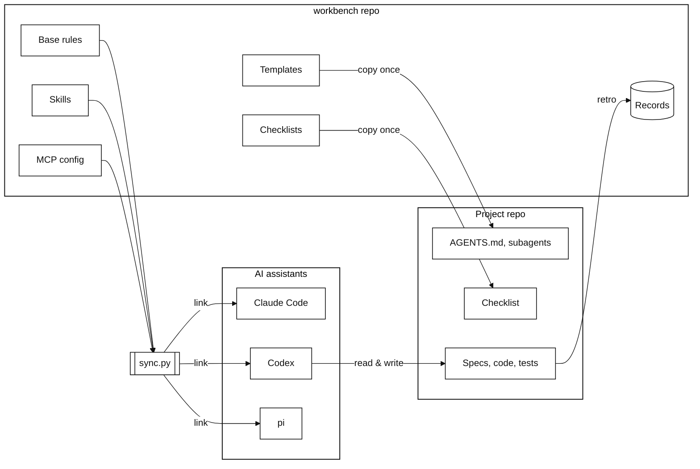
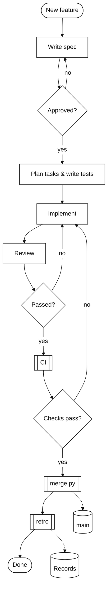

# workbench

简体中文 | [English](README.en.md)

个人 AI 编程工作流仓库：让 Claude Code、Codex、pi 在不同业务仓库里遵守同一套规则、技能和检查。

原则：跨仓库复用的放这里，只属于某个项目的留在那个项目里；能被工具检查的交给工具，不写进提示词。

## 架构

### 架构图



### 流程图



## 目录

```
workbench/
├── base/                     # 基底层：所有仓库、所有助手共用
│   ├── AGENTS.md             # 60 行以内的工程原则
│   └── CLAUDE.md             # 一行 @AGENTS.md
├── docs/workflow.md          # 开发流程细则：任务拆分、问题处理、收尾验收
├── skills/                   # 通用技能，一个动作一个技能
│   ├── code-review/SKILL.md  # 代码评审
│   ├── write-tests/SKILL.md  # 写测试
│   ├── tech-research/SKILL.md # 新功能调研
│   ├── requirements-design/  # 需求设计：SKILL.md 与按功能类型区分的参考文件
│   ├── retro/SKILL.md        # 复盘：汇总进度、问题与基线数据
│   └── role-*/               # 6 个协作角色：产品经理、负责人、规划者、执行者、审查者、专项审查者
├── templates/
│   ├── algorithm/            # 刷题类 Go 仓库模板（说明见 TEMPLATE.md）
│   └── fullstack/            # 前后端多 agent 协作模板：子 agent 配置、接口影响索引、测试保护钩子
├── .github/workflows/
│   ├── go-ci.yml             # 可复用 CI：gofmt、vet、golangci-lint、test；main 失败开 issue
│   └── ci.yml                # 本仓库自身的 CI（同步脚本的测试）
├── mcp/servers.json          # 通用 MCP，统一用标准 mcpServers 格式
├── configs/targets.toml      # 各工具读取规则、技能、MCP 的位置
├── scripts/
│   ├── bootstrap.py          # 新电脑初始化：检查工具、装 ccusage、配状态栏
│   ├── sync.py               # 同步：分发基底层、技能、MCP
│   └── merge.py              # 合并：检查全部通过才压缩合并（护栏第 3 层）
├── tests/                    # 脚本的测试
└── evals/                    # 测试点清单、常见问题清单、跨项目记录（进度、问题、基线）
```

## 新电脑初始化

```sh
python scripts/bootstrap.py --dry-run   # 先看会改什么
python scripts/bootstrap.py
```

列出缺哪些工具和安装命令；用 npm 装 ccusage；在 `~/.claude/settings.json` 里加 `ccusage statusline` 状态栏（已有自定义状态栏时保留，`--force` 才替换）。

## 同步到各工具

需要 Python 3.11 以上，不用装任何依赖。在本仓库根目录：

```sh
python scripts/sync.py --dry-run   # 先看会改什么
python scripts/sync.py             # 执行
```

Windows、WSL、Linux 各自是独立的主目录，每个环境各跑一次。

同步内容和目标位置见 [configs/targets.toml](configs/targets.toml)：

| 内容 | Claude Code | Codex | pi |
|------|-------------|-------|----|
| 基底层 | ~/.claude/AGENTS.md + CLAUDE.md | ~/.codex/AGENTS.md | ~/.pi/agent/AGENTS.md |
| 技能 | ~/.claude/skills/ | ~/.agents/skills/ | ~/.agents/skills/ |
| MCP | `claude mcp add-json --scope user` | ~/.codex/config.toml 的 mcp_servers | ~/.config/mcp/mcp.json（需装 pi-mcp-adapter） |

脚本行为：

- 能建符号链接就建链接；Windows 没开开发者模式时自动改为复制（改了仓库内容要重新跑）。
- 覆盖已有文件前备份到 `~/.workbench-backup/<日期>/`。
- Codex 的 config.toml 只替换同名的 `[mcp_servers.<名字>]` 表，其他设置保留；pi 的 mcp.json 只替换同名条目。
- 重复运行结果不变，第二次会提示“全部已是最新”。

## MCP

只在 [mcp/servers.json](mcp/servers.json) 里改，其他格式由同步脚本生成。密钥只写成 `${VAR}` 环境变量引用，例如给 Context7 加 API key：

```json
"headers": { "CONTEXT7_API_KEY": "${CONTEXT7_API_KEY}" }
```

转换到 Codex 时，`${VAR}` 形式的请求头变成 `env_http_headers`，`Authorization: Bearer ${VAR}` 变成 `bearer_token_env_var`。

## 开发流程

新功能开发分为四步，细则见 [docs/workflow.md](docs/workflow.md)：

1. **需求设计**：使用 [requirements-design](skills/requirements-design/SKILL.md) 技能，按功能类型选读参考文件，产出功能 spec，并根据规模选定轻量或完整协作档位。此前未实现过的功能先用 [tech-research](skills/tech-research/SKILL.md) 调研。
2. **任务拆分与协作**：规划者拆分任务并先写验收测试，执行者实现，另一个 agent 审查；各角色的职责以 role-* 技能为准，Claude Code 与 Codex 共用同一份。接口变更以契约和接口影响索引为准，关键节点须经人工确认。
3. **问题处理**：记录 AI 出错的过程；测试文件禁止 agent 修改，由钩子与 merge.py 两层把关；同一问题连续两次未解决即转人工。
4. **收尾验收与复盘**：检查测试、亲自操作、按[常见问题清单](evals/checklists/common-issues/README.md)（功能、语言、框架与中间件、依赖、资源开销、测试本身、运行环境七层）逐项核对；随后用 [retro](skills/retro/SKILL.md) 技能将进度、问题与基线数据汇总到 [evals/records/](evals/records/README.md)，各项目的记录集中查看。

## 新建业务仓库

刷题类见 [templates/algorithm/TEMPLATE.md](templates/algorithm/TEMPLATE.md)，前后端多 agent 协作类见 [templates/fullstack/TEMPLATE.md](templates/fullstack/TEMPLATE.md)。业务仓库的 CI 只写几行调用本仓库的 go-ci.yml 并固定版本号；本仓库是私有的话，需要在 Settings → Actions → General → Access 里允许自己名下的其他仓库调用。

## 合并 PR

私有仓库免费版没有分支保护，不在网页上点合并，改用：

```sh
python <workbench 路径>/scripts/merge.py <PR 编号>
```

等 PR 的检查全部跑完；全部通过才压缩合并并删除分支，有失败、没有检查、还是草稿或已关闭都拒绝。需要已登录的 gh。

PR 修改、删除或重命名已有测试文件时同样拒绝合并（新增测试不受影响），审阅相关测试后加 `--allow-test-changes` 方可合并。该检查是对 fullstack 模板中测试保护钩子的补充。

## 脚本语言约定

| 场景 | 语言 | 原因 |
|------|------|------|
| 同步、合并等要在 Windows/WSL/Linux 都跑的工具脚本 | Python（只用标准库） | 跨平台，自带 JSON/TOML 解析，好写测试 |
| 部署脚本（例如以后 python-service 的部署） | sh | Linux 服务器和容器都自带，串命令最直接 |
| 钩子、CI 里的单行命令 | sh | 由 lefthook / GitHub Actions 直接执行 |

## 开发

```sh
ruff check . && ruff format --check . && python -m unittest discover -s tests
```

## 技能规划

需求分析里列了 6 个通用技能，按“同一个要求说到第三次再沉淀”的原则逐个加：

| 技能 | 状态 |
|------|------|
| code-review 代码评审 | 第一批 |
| write-tests 写测试 | 第一批 |
| tech-research 新功能调研 | 第二批 |
| requirements-design 需求设计 | 第二批 |
| role-* 协作角色（6 个） | 第二批 |
| clarify 需求澄清 | 暂由 requirements-design 覆盖，需要时再拆分 |
| domain-model 领域建模（含数据建模） | 暂由 requirements-design 覆盖，需要时再拆分 |
| define-contract 定义契约与非功能需求 | 暂由 requirements-design 覆盖，需要时再拆分 |
| retro 复盘 | 第二批 |

只属于某个仓库的技能（例如 leetcode-go 的刷题技能）放在那个仓库里。
